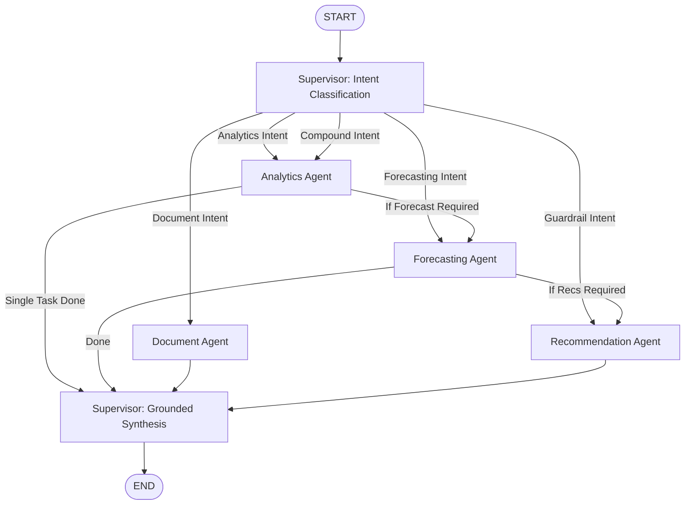

# LangGraph Multi-Agent Architecture Specification

InsightAI implements a multi-agent state graph orchestrated with LangGraph.

## State Graph Architecture

## Agent Specialization

### 1. Supervisor / Orchestrator Agent
- Evaluates the user's intent from natural language questions or explicit modes (`auto`, `analyze`, `forecast`, `documents`, `recommendations`).
- Decomposes compound inquiries (e.g., *"What are my top products and what will sales be next month?"*).
- Delegates execution to specialized agents and synthesizes outputs into a coherent executive report.
- Never invents or fabricates numerical metrics when data is unavailable.

### 2. Analytics Agent
- Executes approved, parameterized SQL analytics with strict tenant isolation.
- Computes gross sales, COGS, gross margin percentage, net operating profit, and product profitability rankings.
- Generates structured chart data for frontend visualizations.

### 3. Forecasting Agent
- Fits adaptive exponential smoothing with damped linear trend extrapolation on daily aggregated historical sales.
- Produces 95% confidence bounds (expanding prediction intervals).
- Evaluates models with backtested MAE, RMSE, and MAPE metrics.
- Flags data sufficiency warnings when historical data is under 14 days.

### 4. Document Intelligence Agent (RAG)
- Extracts text from uploaded supplier agreements, return policies, and invoices.
- Performs semantic retrieval across document chunks.
- Returns grounded answers backed by direct document citations and relevance scores.

### 5. Recommendation Agent
- Evaluates deterministic business guardrails:
  - Critical stock-out alerts (`current_stock == 0`).
  - Low stock warning (`current_stock <= reorder_threshold`).
  - Margin compression warnings (gross profit <= 5%).
  - Customer khata overdue balances.
