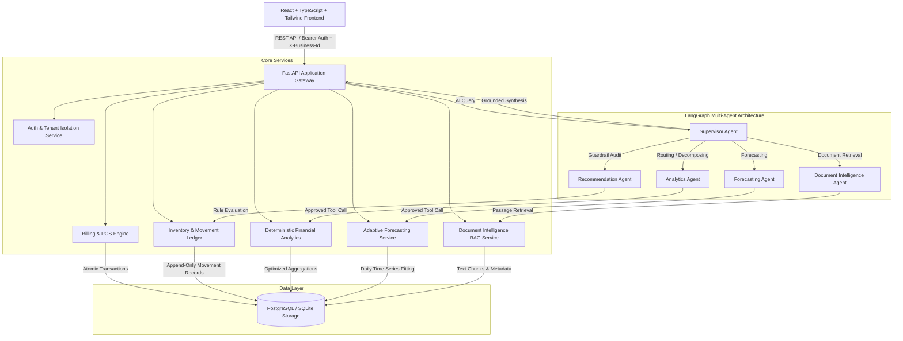

# InsightAI Architecture Specification

## Overview

InsightAI is a modular, multi-tenant Business Operations and Multi-Agent Intelligence SaaS platform designed for retail shops, distributors, and growing enterprises.

The system connects transactional commerce (POS, inventory movements, purchases, expenses) directly with analytical and AI reasoning layers without compromising transactional atomicity or data security.

## Architectural Principles

1. **Strict Modular Monolith**: Transactional business workflows, analytical calculations, and multi-agent coordination reside in clearly separated modules within a cohesive codebase.
2. **Deterministic Financial Correctness**: Numerical analytics, gross margin calculations, and financial summaries are computed deterministically using SQL/Python (Pandas/NumPy) rather than relying on LLM arithmetic hallucinations.
3. **Multi-Tenancy by Design**: Every database table, document chunk, invoice, and AI execution enforces tenant ownership via `business_id` and role-based permissions (`owner`, `manager`, `cashier`).
4. **Append-Only Stock Ledger**: Stock quantities are maintained alongside an immutable `stock_movements` ledger to guarantee auditability and prevent silent stock discrepancies.
