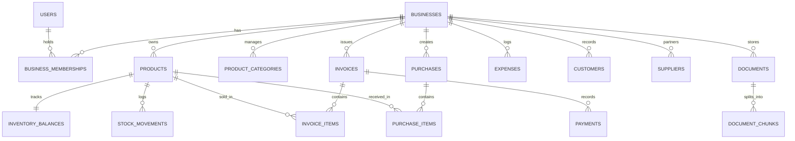

# InsightAI Database Schema & Model Specification

InsightAI utilizes normalized SQLAlchemy 2.0 declarative models supporting both PostgreSQL and SQLite.

## Entity Relationship Overview

## Core Database Tables

### 1. Identity & Multi-Tenancy
- `users`: User identity, bcrypt hashed passwords, active status.
- `businesses`: Workspace records, sequential invoice prefix and next sequence number, currency, tax identifier.
- `business_memberships`: Role assignment (`owner`, `manager`, `cashier`) mapping user to business.
- `audit_logs`: Provenance tracking for user/system actions.

### 2. Product Catalogue & Inventory
- `product_categories`: Grouping for catalog items.
- `products`: SKU, barcode, unit of measure, `selling_price` (Decimal), `purchase_cost` (Decimal), `tax_rate`, `reorder_threshold`.
- `inventory_balances`: Real-time stock levels (`current_stock`, `reserved_stock`).
- `stock_movements`: Immutable ledger recording every movement (`sale`, `purchase`, `return`, `adjustment`, `damage`, `opening`), delta, and resulting balance.

### 3. Billing & Operations
- `invoices`: Sequential invoice number, customer reference, `subtotal`, `discount_amount`, `tax_amount`, `total_amount`, `paid_amount`, `balance_amount`, `payment_status`, `payment_method`.
- `invoice_items`: Snapshot of unit price, purchase cost at time of sale, quantity, tax, line total.
- `payments`: Cash/UPI/card records against invoices.
- `purchases` & `purchase_items`: Restock receipts updating inventory balances.
- `expenses`: Categorized operating expenses.

### 4. Intelligence & RAG
- `documents`: Uploaded document metadata, file paths, chunk count.
- `document_chunks`: Isolated text passages with chunk index and source metadata.
- `forecast_runs`: Backtesting evaluation metrics (MAE, RMSE, MAPE) and stored projections.
- `business_recommendations`: Deterministic rule alerts with severity and status.
- `ai_conversations` & `ai_messages`: Multi-agent conversation history.
